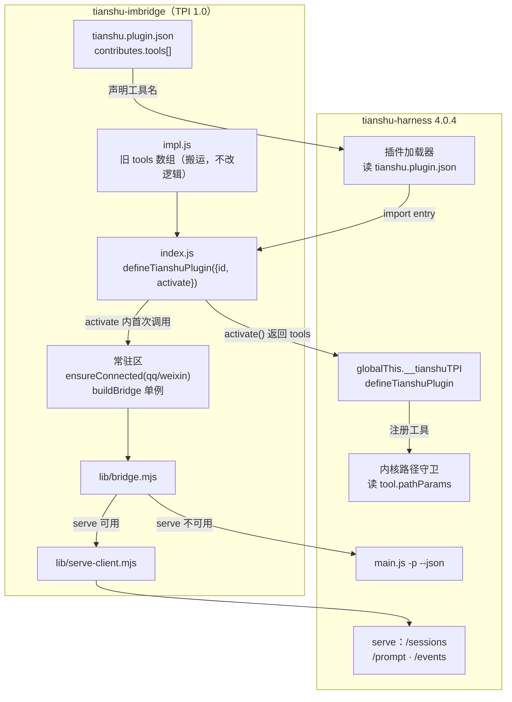
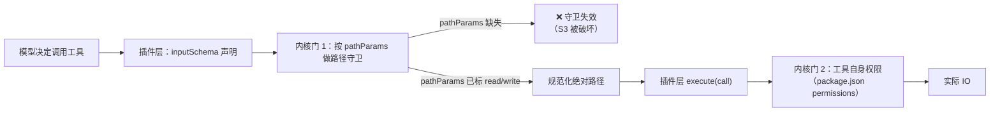

# tianshu-imbridge 适配天枢 4.0.4（TPI 插件契约）实现计划

> **面向 AI 代理：** 逐任务实现并按波验证（原生计划执行纪律），或直接用 team_orchestrate 的 planPath/planMarkdown 编排多任务。零上下文假设：每个任务都写了为什么改、改哪个文件、怎么验。

**目标：** 让 `tianshu-imbridge` 在 tianshu-harness 4.0.4 下重新被宿主加载，QQ/微信双通道恢复收发。

**架构：** 4.0.4 用 TPI（Tianshu Plugin Interface）替换了 3.x 的「`package.json.tianshu` 字段 + `export const tools`」插件模型。迁移分三块：① 新增 `tianshu.plugin.json` 清单；② 把工具实现下沉到 `impl.js`，`index.js` 改为 `defineTianshuPlugin({ id, activate })` 的 TPI 入口；③ 把原来挂在模块顶层的常驻逻辑（QQ/微信连接、桥单例）挪进 `activate()` 并加幂等守卫。serve/headless 两条回复通道的契约需先探针取证再改——运行时经混淆，静态 grep 结论不可信。

**技术栈：** Node ESM · tianshu-harness 4.0.4（TPI 1.0）· `node --test` · 现有 `lib/` 模块（bridge / serve-client / qq / weixin）

---

## 背景与根因（已取证，勿重查）

真源仓库：`D:\GitHub_place\plugins\tianshu-imbridge`（git main，v0.6.0，HEAD `636aa6e`，428 测试全绿）。
部署副本：`D:\Tianshu\TianshuData\.rivet\plugins\tianshu-imbridge`（与真源逐字节一致）。
天枢运行时：`D:\Tianshu\rivet-runtime`（tianshu-harness **4.0.4**）。

| 编号 | 事实 | 证据 |
| --- | --- | --- |
| F1 | 运行时不接受旧清单 | `GET /plugins/installed` 对全部 5 个已装插件返回 `"invalid": "not a TPI plugin: \"tianshu\" field in package.json is no longer accepted; describe the plugin in tianshu.plugin.json"`，`toolCount: 0` |
| F2 | 3.36.0 时代插件正常 | `logs/sidecar-2026-10-27T12-35-03.1848949Z.log` 有 `[tianshu-imbridge] QQ 连接就绪` |
| F3 | 4.0.4 启动日志无任何插件行 | `logs/sidecar-2026-11-08T09-03-14.0347675Z.log` 有 `phase=plugins-warm`，但 0 条 `[tianshu-imbridge]` |
| F4 | 新清单 schema 见 `D:\Tianshu\plugins\hello-world\tianshu.plugin.json` | `$tpi/kind/id/displayName/version/description/runtime/entry/capabilities/contributes/permissions` |
| F5 | 新入口形态 | `hello-world/index.js`：`export default defineTianshuPlugin({ id, activate() { return { tools: [...] } } })` |
| F6 | `tpi.js` 是随插件分发的 SDK 垫片 | 转发到 `globalThis.__tianshuTPI.defineTianshuPlugin`，宿主外调用抛错 |
| F7 | 工具形状变了 | 新：`{ name, description, inputSchema, concurrencySafe, requiresApproval, pathParams, execute(call) }`；旧：`{ definition: { name, description, input_schema }, execute(params), ... }` |
| F8 | 4.0.4 新增插件启用机制 | 新增 `POST /plugins/enable`；`config.json` 里 `plugins.enabled = {}` |
| F9 | Node 版本门槛提高 | 系统 node v24.15.0 直接被拒：`use Node 24.x v24.22.1+ or Node 26.x v26.12.1+`；天枢自带 `D:\Tianshu\node-runtime\win-x64\tianshu-runtime.exe` |
| F10 | serve 路由仍在 | `POST /sessions`、`GET /sessions`、`POST /sessions/:id/prompt`、`GET /sessions/:id/events` 均在 4.0.4 路由表内 |

**已确诊根因：** 插件被宿主判定为「非 TPI 插件」而静默跳过——不是连接层或桥的问题。只要清单与入口不合 TPI 1.0，`lib/` 里再正确也一行不跑。

**尚未确诊（必须探针，见 Wave 0）：**

- `turn_complete` / `approval_required` / `approval_resolved` 三个事件名在 4.0.4 里字面量 grep 为 0，但运行时把字符串切成 `'plugins-wa'`+`'rm'` 这类碎片，静态结论无效 —— serve 模式可能仍然正常，也可能每条消息都会等到 180s 超时。
- `activate()` 的调用次数与时机（决定常驻连接能否挂在里面）。
- headless CLI（`main.js -p --json -c`）参数是否变化。

---

## 架构与数据流



---

## 安全附录

本计划改动插件**入口与工具契约**，直接触及两条执行门：入站授权（谁能指挥天枢）与路径守卫（工具能碰哪些文件）。TPI 迁移会重写工具的注册方式，**若 `pathParams` 漏标，内核路径守卫这道门会静默失效**——属于典型的「迁移时安全默认值丢失」。

### 安全不变量（迁移后必须逐条成立）

| 编号 | 不变量 | 现状位置 | 迁移风险 |
| --- | --- | --- | --- |
| S1 | 未配置 owner 时一律拒收（QQ 与微信各自独立判定） | `lib/qq/authorization.mjs`、`lib/weixin/authorization.mjs` | 低：纯函数，不随入口变 |
| S2 | 微信群聊一律拒收 | `lib/weixin/authorization.mjs` | 低 |
| S3 | **每个接受路径参数的工具必须声明 `pathParams`**，否则内核不做路径守卫 | 3.x 无此概念（新增） | **高**：不声明即降级为无守卫 |
| S4 | 凭据永不进日志、`im_status` 只回掩码 | `lib/qq/config.mjs`、`lib/weixin/config.mjs` | 低 |
| S5 | 审批请求只在 owner 会话内被解释为「批准」 | `lib/bridge.mjs` 的 `#handleServe` / `parseApprovalReply` | 中：依赖审批事件名（Wave 0 待定） |

### 触发路径清单

1. **入站**：IM 消息 → 连接层 `onMessage` → `handleInbound(message, channel)` → `lib/*/authorization.mjs` → `ImBridge.handle` → 命令层或 serve/headless。
2. **工具**：模型调用 `im_send` / `im_status` / `weixin_bind_*` → 宿主按 `inputSchema` 校验 → **内核路径守卫（读 `pathParams`）** → `execute(call)`。
3. **审批**：serve 事件 `approval_required` → `TurnAccumulator` 收集 → 转发到 IM → owner 回复「批准」→ `parseApprovalReply` → 回到会话。

### 双门对齐数据流



**对齐要求：** 清单 `permissions` 声明的能力 ⊇ 工具实际会做的 IO；`pathParams` 的 read/write 标注 ⊇ 工具实际会写的路径。两侧任一不为超集，即为越权放行。

---

### Wave 0：契约取证（探针，先于任何代码改动）

> 波次验证命令（全部执行完再进 Wave 1）：
> ```
> node "D:\Tianshu\会话目录\coding\.rivet\scratch\probe-plugin-api.mjs"
> ```
> 期望：`GET /plugins/installed` 里 `tianshu-imbridge` 的 `invalid` 字段消失、`toolCount` 为 4。

- [ ] **Task 1：确认 `activate()` 的调用次数与常驻逻辑可挂载位置**

  **为什么：** `index.js:270-296` 目前把 `ensureConnected('qq')` / `ensureConnected('weixin')` 挂在模块顶层，靠「ESM 模块只求值一次」保证常驻。TPI 引入 `activate()` 后，宿主可能在每次工具快照重建时重复调用，直接搬过去会开出多条 QQ 连接（QQ 网关对重复连接行为未定义，见 README 安全须知）。

  **文件：** 临时探针 `D:\Tianshu\会话目录\coding\.rivet\scratch\probe-activate-count.mjs`（交付前删除）

  **步骤：**
  1. 在隔离 home 的 `plugins/hello-world/index.js` 副本里，把 `activate()` 改为先 `console.error('[probe] activate#' + (++globalThis.__probeActivate))`。
  2. 起 serve（复用 `probe-plugin-api.mjs` 的启动代码），等 `listen` 后调用三次 `GET /plugins/installed`。
  3. 统计 `[probe] activate#` 出现次数。

  **判据与分支动作：**
  - 恰好 1 次 → 常驻逻辑可安全放在 `activate()` 内，配 `let residentStarted = false` 守卫（Task 7 用此写法）。
  - 多次 → 必须用模块级单例守卫 `if (residentStarted) return; residentStarted = true`（Task 7 增加一行断言测试）。
  - 0 次（激活不发生）→ 停止本波，回到调查：把 `probe-activate-count.mjs` 的完整日志作为证据，改为在 `contributes.lifecycle` 里挂载。

  **验收：** 探针输出中 `activateCount` 为确定数字，写入计划的「执行记录」段。

- [ ] **Task 2：实测 serve 事件类型集合**

  **为什么：** `lib/serve-client.mjs` 的 `TurnAccumulator` 用 `ev.type === 'turn_complete'` 判回合终结、用 `approval_required` / `approval_resolved` 判审批挂起。若 4.0.4 改了事件名，serve 模式下每条消息都会走到 `timeoutMs`（180s）才返回，用户体验是「每条消息都超时」。

  **文件：** `D:\Tianshu\会话目录\coding\.rivet\scratch\probe-events.mjs`（交付前删除）

  **步骤：**
  1. 起隔离 serve（带真实 provider 配置，复制 `config.json`/`auth/`/`account.json`）。
  2. `POST /sessions` 建会话，`POST /sessions/:id/prompt` 发一句 `只回复两个字：收到`。
  3. 每 800ms 拉一次 `GET /sessions/:id/events?since=0`，持续 30s，把**所有出现过的 `event.type` 去重后打印**。

  **判据与分支动作：**
  - 出现 `turn_complete` → 契约未变，Task 12、13 直接标记「无需改动，已实证」。
  - 出现其它终结事件（如 `end_turn` / `message_complete`）→ 记录名字，Task 12 按该名字改 `TurnAccumulator`。
  - 30s 内无任何终结事件 → 记 `timedOut`，Task 12 改为「以 `text_delta` 静默 N 秒 + `lastSeq` 稳定」作为终结判据，并补一条对应单测。

  **验收：** 探针打印形如 `types=[text_delta, turn_complete, ...]` 的确定列表。

- [ ] **Task 3：实测 headless CLI 契约**

  **为什么：** `lib/tianshu.mjs` 的 `buildInvocation` 组装 `main.js -p <prompt> --json -c`，`parseOutput` 从 stdout 里找 JSON 结果行。4.0.4 若改了 flag 或输出格式，headless 模式（TUI / 独立进程）整条链会返回空。

  **命令：**
  ```
  "D:\Tianshu\node-runtime\win-x64\tianshu-runtime.exe" "D:\Tianshu\rivet-runtime\main.js" -p "只回复两个字：收到" --json -c
  ```
  （cwd 设为 `D:\Tianshu\会话目录\coding`，`RIVET_HOME` 指向真实数据目录）

  **判据与分支动作：**
  - 退出码 0 且 stdout 末行是可 `JSON.parse` 的对象、含文本字段 → 契约未变，Task 14 标「无需改动」。
  - 退出码非 0 或报未知 flag → 跑 `main.js --help` 抓真实 flag 列表，Task 14 按实际重写 `buildInvocation`。
  - 输出改为纯文本（无 JSON）→ Task 14 改 `parseOutput`：整段 stdout 视为文本，保留 `--json` 探测失败时的降级路径。

  **验收：** 命令退出码 + stdout 末 3 行，原样贴进执行记录。

- [ ] **Task 4：确认 `plugins.enable` 的启用语义**

  **为什么：** F8 显示 4.0.4 新增 `POST /plugins/enable`，当前 `config.json` 的 `plugins.enabled` 是空对象。若启用是必需步骤，README 安装章节必须加这一步，否则用户装完仍然静默不加载。

  **文件：** 复用 `probe-plugin-api.mjs`（已证明 `enabled: true` 与 `invalid` 可同时存在）

  **步骤：**
  1. 在隔离 home 写入合法的 `tianshu.plugin.json` 后起 serve。
  2. `GET /plugins/installed` 看 `invalid` 是否消失、`toolCount` 是否 > 0。
  3. 对比「`plugins.enabled` 为空」与「已写入 id」两种 home 的 `installed` 输出差异。

  **判据：** 若 `enabled: {}` 时插件仍被加载（`invalid` 为空、tools 已注册），结论为「启用是可选开关」；若为空时不被加载，结论为「必须在桌面端启用」，README 必须加步骤。

- [ ] **Task 5：固定真源与部署副本的差异基线**

  **为什么：** 迁移会同时改真源与部署副本，先记录一份可复现的基线，避免后面「改了哪份」说不清。

  **命令：**
  ```
  cd /d D:\GitHub_place\plugins\tianshu-imbridge && git status --short && git rev-parse HEAD
  ```
  **验收：** 输出写进执行记录；工作区必须干净（不干净先 `git stash list` 核实来源，不要直接 reset）。

---

### Wave 1：TPI 入口迁移（根因修复）

> 波次验证命令：
> ```
> cd /d D:\GitHub_place\plugins\tianshu-imbridge && node --test
> ```
> 期望：`428 pass / 0 fail`（新增用例后数字上升，失败数必须为 0）。

- [ ] **Task 6：新增 `tpi.js` 垫片**

  **为什么：** TPI 插件必须通过宿主注入的 `globalThis.__tianshuTPI` 注册，宿主外直接 import 应当抛错——这保证插件不会被误当普通模块加载（3.x 的 `export const tools` 就存在这种误用空间）。

  **文件：** 创建 `tpi.js`

  **代码：**
  ```js
  /**
   * TPI SDK 入口（随插件分发）。只在天枢宿主内可用：宿主加载插件前安装全局 SDK，
   * 宿主之外 import 本插件会直接抛错——TPI 插件不能脱离天枢运行。
   */
  export function defineTianshuPlugin(spec) {
    const sdk = globalThis.__tianshuTPI
    if (!sdk) throw new Error('not running inside Tianshu: TPI plugins load only through the Tianshu host')
    return sdk.defineTianshuPlugin(spec)
  }
  ```

  **测试（RED 先行）：** 创建 `test/tpi.test.mjs`
  ```js
  import test from 'node:test'
  import assert from 'node:assert/strict'
  import { defineTianshuPlugin } from '../tpi.js'

  test('宿主外调用 defineTianshuPlugin 抛错', () => {
    assert.throws(() => defineTianshuPlugin({ id: 'x' }), /not running inside Tianshu/)
  })

  test('宿主存在时转发给 globalThis.__tianshuTPI', () => {
    const seen = []
    globalThis.__tianshuTPI = { defineTianshuPlugin: (s) => { seen.push(s); return { ok: true } } }
    try {
      const out = defineTianshuPlugin({ id: 'x' })
      assert.deepEqual(out, { ok: true })
      assert.equal(seen.length, 1)
    } finally {
      delete globalThis.__tianshuTPI
    }
  })
  ```
  1. 先只写测试跑 `node --test test/tpi.test.mjs` → **RED**：`Cannot find module '../tpi.js'`
  2. 写 `tpi.js` → **GREEN**

  **commit：** `feat(tpi): 新增 TPI SDK 垫片，宿主外调用即抛错`

- [ ] **Task 7：工具实现下沉到 `impl.js`（纯搬运，不改逻辑）**

  **为什么：** TPI 入口的 `activate()` 要返回符合新形状的工具数组，而现有 `index.js:343` 的 `export const tools` 是旧形状（`definition.input_schema` / `execute(params)`）。把业务实现原样搬到 `impl.js`，让 `index.js` 只剩「描述与握手」——这是官方迁移样板（`D:\Tianshu\plugins\tianshu-imbridge\index.js`）的做法，也是最小 diff 的搬法。

  **文件：** 创建 `impl.js`；修改 `index.js`

  **步骤：**
  1. 把 `index.js` 里 `export const tools = [...]`（L343 起至文件末尾）整段剪切到 `impl.js`，导出同名 `export const tools`。
  2. `impl.js` 顶部补上它用到的依赖：`logger`、`state`、`qqConfig`、`connection`、`pickConnector`、`sessionMap`。这些目前在 `index.js` 里是模块级变量——**改为从 `runtime.js` 取**（Task 8 创建），避免 `impl.js` ↔ `index.js` 循环依赖。
  3. `index.js` 末尾改为 `export { tools } from './impl.js'`（过渡一行，Task 9 删除）。

  **测试（RED 先行）：** 创建 `test/plugin-entry.test.mjs`（若已存在则追加）
  ```js
  import test from 'node:test'
  import assert from 'node:assert/strict'

  test('impl.js 导出 4 个工具且形状为旧契约', async () => {
    const { tools } = await import('../impl.js')
    assert.equal(tools.length, 4)
    for (const t of tools) {
      assert.equal(typeof t.definition?.name, 'string')
      assert.equal(typeof t.definition?.input_schema, 'object')
      assert.equal(typeof t.execute, 'function')
    }
    assert.deepEqual(tools.map((t) => t.definition.name).sort(),
      ['im_send', 'im_status', 'weixin_bind_start', 'weixin_bind_status'])
  })
  ```
  先跑 → **RED**（`Cannot find module '../impl.js'`）→ 搬运 → **GREEN**

  **commit：** `refactor(tpi): 工具实现下沉到 impl.js，逻辑零改动`

- [ ] **Task 8：抽出常驻态到 `runtime.js`（连接、桥、配置的统一持有者）**

  **为什么：** 3.x 的常驻逻辑（`index.js:50-53` 的 `qqConfig`/`weixinConfig`、L54-160 的 `ensureConnected`、L162-241 的 `buildBridge`、L270-296 的顶层启动块）与工具实现共享模块级状态。TPI 拆分后这两半在不同文件，必须有一个第三方持有者，否则要么循环依赖、要么各自一份状态（会出现「工具看到 connection 为 null，但连接其实活着」）。

  **文件：** 创建 `runtime.js`；修改 `index.js`、`impl.js`

  **步骤：**
  1. `runtime.js` 导出 `state`、`logger`、`connections`、`ensureConnected(channel)`、`ensureConnection()`、`buildBridge()`、`getConfig(channel)`、`pickConnector(target, preferred)`——全部从 `index.js` 原样搬移，函数体不改。
  2. `index.js` 从 `runtime.js` import 这些符号并使用；`impl.js` 同样。
  3. 搬移后用 `node --test` 确认既有 428 例全绿（这是纯重构，任何红都是搬漏了）。

  **测试（RED 先行）：** 在 `test/plugin-entry.test.mjs` 追加
  ```js
  test('runtime.js 暴露常驻态访问器，重复调用 ensureConnected 不重复建连', async () => {
    const rt = await import('../runtime.js')
    assert.equal(typeof rt.ensureConnected, 'function')
    assert.equal(typeof rt.buildBridge, 'function')
    assert.equal(typeof rt.pickConnector, 'function')
    // 未配置的通道返回 null，而不是抛错
    assert.equal(await rt.ensureConnected('not-a-channel'), null)
  })
  ```
  先跑 → **RED**（模块不存在）→ 提取 → **GREEN**

  **commit：** `refactor(tpi): 常驻态收敛到 runtime.js，工具与入口共享同一份状态`

- [ ] **Task 9：`index.js` 改为 TPI 入口（含 activate 幂等守卫）**

  **为什么：** 这是修复 F1 的那一步。`activate()` 返回新形状工具数组；常驻连接在此启动一次（守卫按 Task 1 的实测结论定形态）。`pathParams` 必须按 S3 标注——漏标等于关掉内核路径守卫。

  **文件：** 重写 `index.js`

  **代码：**
  ```js
  /**
   * tianshu-imbridge — TPI 入口（tianshu-harness 4.0.4 / TPI 1.0）。
   * 工具实现在 impl.js，常驻态在 runtime.js；这里只做描述与握手。
   */
  import { defineTianshuPlugin } from './tpi.js'
  import { tools as implTools } from './impl.js'
  import { ensureConnected, logger } from './runtime.js'

  /** 接收文件路径的参数 → 守卫模式。不在此表内的路径参数不会被内核守卫。 */
  const PATH_PARAMS = { path: 'write', workspace: 'write', dataDir: 'write' }
  const WRITE_TOOL = /bind|install|deploy/

  function pathParamsFor(tool) {
    const props = tool.definition.input_schema?.properties ?? {}
    const out = {}
    for (const key of Object.keys(props)) {
      if (!(key in PATH_PARAMS)) continue
      out[key] = PATH_PARAMS[key] === 'write' || (key === 'path' && WRITE_TOOL.test(tool.definition.name))
        ? 'write'
        : 'read'
    }
    return out
  }

  let residentStarted = false

  export default defineTianshuPlugin({
    id: 'tianshu-imbridge',
    activate() {
      if (!residentStarted) {
        residentStarted = true
        // 常驻区：配置存在则各自建连（互不 await，失败互不牵连）
        void ensureConnected('qq').catch((e) => logger.error('QQ 常驻初始化失败:', e?.message ?? e))
        void ensureConnected('weixin').catch((e) => logger.error('微信常驻初始化失败:', e?.message ?? e))
      }
      return {
        tools: implTools.map((tool) => ({
          name: tool.definition.name,
          description: tool.definition.description,
          inputSchema: tool.definition.input_schema,
          concurrencySafe: tool.isConcurrencySafe?.() === true,
          requiresApproval: tool.requiresApproval?.() === true,
          pathParams: pathParamsFor(tool),
          execute: (call) => tool.execute(call.args),
        })),
      }
    },
  })
  ```

  **测试（RED 先行）：** 在 `test/plugin-entry.test.mjs` 追加
  ```js
  test('TPI 入口：activate 返回 4 个工具，形状为新契约，且重复 activate 只建一次常驻', async () => {
    const calls = []
    globalThis.__tianshuTPI = {
      defineTianshuPlugin: (spec) => { calls.push(spec); return spec },
    }
    try {
      const mod = await import('../index.js?tpi-entry')
      const spec = mod.default
      assert.equal(spec.id, 'tianshu-imbridge')
      const out = spec.activate()
      assert.equal(out.tools.length, 4)
      for (const t of out.tools) {
        assert.equal(typeof t.name, 'string')
        assert.equal(typeof t.inputSchema, 'object')
        assert.equal(typeof t.execute, 'function')
        assert.equal(typeof t.pathParams, 'object')
        assert.equal('definition' in t, false, '不得残留旧契约字段')
      }
      spec.activate()
      assert.equal(calls.length, 1, '模块求值只注册一次')
    } finally {
      delete globalThis.__tianshuTPI
    }
  })

  test('pathParams：im_send 的 targetId 不是路径参数，不得进入守卫表', async () => {
    globalThis.__tianshuTPI = { defineTianshuPlugin: (s) => s }
    try {
      const mod = await import('../index.js?tpi-entry2')
      const { tools } = mod.default.activate()
      const imSend = tools.find((t) => t.name === 'im_send')
      assert.deepEqual(imSend.pathParams, {})
    } finally {
      delete globalThis.__tianshuTPI
    }
  })
  ```
  先跑 → **RED**（`undefined` 无 `activate`）→ 改 `index.js` → **GREEN**

  **验证 S3：** 断言「任何 `inputSchema.properties` 含 `path`/`workspace`/`dataDir` 的工具，其 `pathParams` 对应键非空」。

  **commit：** `feat(tpi): 入口迁移到 defineTianshuPlugin，常驻连接幂等启动`

- [ ] **Task 10：新增 `tianshu.plugin.json`**

  **为什么：** 宿主靠这份清单发现插件（F1 的报错原文点名要它）。工具清单必须与 `impl.js` 完全一致，否则宿主可能注册不到工具或校验失败。

  **文件：** 创建 `tianshu.plugin.json`

  **代码：**
  ```json
  {
    "$tpi": "1.0",
    "kind": "tianshu.plugin",
    "id": "tianshu-imbridge",
    "displayName": "IM 桥接",
    "version": "0.7.0",
    "description": "手机 QQ / 微信 <-> 天枢直连桥：原生会话、命令层、交互转发",
    "runtime": "agent",
    "entry": "index.js",
    "capabilities": ["tools"],
    "contributes": {
      "tools": [
        { "name": "im_status", "description": "报告运行模式、通道连接、会话映射与收发统计" },
        { "name": "im_send", "description": "主动给 owner 发消息（通知用），可指定通道" },
        { "name": "weixin_bind_start", "description": "启动微信扫码绑定：二维码放桌面并后台等待" },
        { "name": "weixin_bind_status", "description": "查询微信绑定进展与下一步" }
      ],
      "lifecycle": []
    },
    "permissions": { "fs": true, "net": true }
  }
  ```

  **测试（RED 先行）：** 创建 `test/manifest.test.mjs`
  ```js
  import test from 'node:test'
  import assert from 'node:assert/strict'
  import { readFileSync } from 'node:fs'

  const manifest = JSON.parse(readFileSync(new URL('../tianshu.plugin.json', import.meta.url), 'utf8'))

  test('清单符合 TPI 1.0 必填字段', () => {
    assert.equal(manifest.$tpi, '1.0')
    assert.equal(manifest.kind, 'tianshu.plugin')
    assert.equal(manifest.id, 'tianshu-imbridge')
    assert.equal(manifest.runtime, 'agent')
    assert.equal(manifest.entry, 'index.js')
    assert.deepEqual(manifest.capabilities, ['tools'])
  })

  test('清单工具名与 impl.js 完全一致（不多不少）', async () => {
    const { tools } = await import('../impl.js')
    const declared = manifest.contributes.tools.map((t) => t.name).sort()
    const actual = tools.map((t) => t.definition.name).sort()
    assert.deepEqual(declared, actual)
  })

  test('version 与 package.json 的 version 一致', () => {
    const pkg = JSON.parse(readFileSync(new URL('../package.json', import.meta.url), 'utf8'))
    assert.equal(manifest.version, pkg.version)
  })
  ```
  先跑 → **RED**（文件不存在）→ 建文件 → **GREEN**

  **commit：** `feat(tpi): 新增 tianshu.plugin.json 清单（TPI 1.0）`

- [ ] **Task 11：清理 `package.json` 的旧字段并补 `engines`**

  **为什么：** `package.json` 里的 `tianshu` 字段已被宿主明确拒绝（F1 原文）。留着不但无用，还会让后来者以为它是配置来源。`engines` 是 F9 的落地：4.0.4 要求 Node ≥24.22.1，项目的 `tools/*.mjs` 与测试都跑在 Node 上。

  **文件：** 修改 `package.json`

  **步骤：**
  1. 删除整个 `"tianshu": { ... }` 对象（保留 `name`/`version`/`description`/`license`/`private`/`type`/`scripts`/`dependencies`）。
  2. `version` 从 `0.6.0` 改为 `0.7.0`（与 Task 10 的清单一致）。
  3. 追加：
     ```json
     "engines": { "node": ">=24.22.1" }
     ```

  **测试（RED 先行）：** 在 `test/manifest.test.mjs` 追加
  ```js
  test('package.json 不再包含被宿主拒绝的 tianshu 字段', () => {
    const pkg = JSON.parse(readFileSync(new URL('../package.json', import.meta.url), 'utf8'))
    assert.equal('tianshu' in pkg, false)
    assert.match(pkg.engines.node, /24\.22\.1/)
  })
  ```
  先跑 → **RED** → 改 → **GREEN**

  **commit：** `chore(tpi): 移除被废弃的 package.json.tianshu 字段并声明 Node 版本要求`

---

### Wave 2：按 Wave 0 真值适配回复通道

> 波次验证命令：
> ```
> cd /d D:\GitHub_place\plugins\tianshu-imbridge && node --test test/serve-client.test.mjs test/tianshu.test.mjs
> ```

- [ ] **Task 12：校准 serve 回合终结判据**

  **文件：** `lib/serve-client.mjs`（`TurnAccumulator.feed` / `isComplete`）、`test/serve-client.test.mjs`

  **按 Task 2 结论执行其一：**
  - **A. `turn_complete` 仍在** → 不改代码。在 `test/serve-client.test.mjs` 顶部追加注释 `// 2026-11-08 实测：4.0.4 仍发 turn_complete（探针 probe-events.mjs）`，任务标记完成。
  - **B. 改为其它终结事件名 `<NAME>`** → 在 `feed()` 里把 `ev.type === 'turn_complete'` 替换为 `ev.type === '<NAME>'`，并保留旧名兼容：`|| ev.type === 'turn_complete'`。补一条测试：
    ```js
    test('4.0.4 终结事件 <NAME> 能结束回合', () => {
      const acc = new TurnAccumulator({ graceMs: 0 })
      acc.feed([{ seq: 1, type: 'text_delta', data: { text: '好' } }, { seq: 2, type: '<NAME>', data: {} }])
      assert.equal(acc.isComplete(Date.now()), true)
      assert.equal(acc.text(), '好')
    })
    ```
    RED（当前不识别）→ 改 → GREEN。
  - **C. 无终结事件** → `isComplete` 增加静默判据：`lastTextAt` 记录最后一次 `text_delta` 时间，`nowMs - lastTextAt >= silenceMs`（默认 4000）且 `text()` 非空即视为完成。补测试：
    ```js
    test('无终结事件时，静默 4 秒视为回合结束', () => {
      const acc = new TurnAccumulator({ graceMs: 0, silenceMs: 4000 })
      acc.feed([{ seq: 1, type: 'text_delta', data: { text: '好' } }], 1000)
      assert.equal(acc.isComplete(3000), false)
      assert.equal(acc.isComplete(5001), true)
    })
    ```

  **commit：** 对应分支 `fix(serve): 校准 4.0.4 回合终结判据` 或 `test(serve): 记录 4.0.4 事件契约实测结论`

- [ ] **Task 13：校准审批事件转发**

  **文件：** `lib/serve-client.mjs`（`feed` 里的 `approval_required` / `approval_resolved` 分支）、`test/serve-client.test.mjs`

  **按 Task 2 结论执行其一：**
  - **A. 两个事件名仍在** → 不改代码，同 Task 12 在测试文件加实测注释。
  - **B. 改名** → 在两个 `else if` 分支各加新名（保留旧名），补一条测试：
    ```js
    test('4.0.4 审批事件名可用，未决审批能被收集', () => {
      const acc = new TurnAccumulator({ graceMs: 0 })
      acc.feed([{ seq: 1, type: '<NEW_REQUIRED>', data: { requestId: 'r1', toolName: 'bash', input: {} } }])
      assert.equal(acc.pendingApprovals().length, 1)
      acc.feed([{ seq: 2, type: '<NEW_RESOLVED>', data: { requestId: 'r1' } }])
      assert.equal(acc.pendingApprovals().length, 0)
    })
    ```
  - **C. 审批不再经事件流** → 在 `test/serve-client.test.mjs` 记录实测证据，`lib/bridge.mjs` 的审批转发路径改为「不启用」，并在 README 已知限制里写明「4.0.4 起审批需在电脑端处理」。

  **commit：** `fix(serve): 适配 4.0.4 审批事件` 或 `docs: 记录审批转发在 4.0.4 下的实际形态`

- [ ] **Task 14：校准 headless 调用**

  **文件：** `lib/tianshu.mjs`（`buildInvocation` / `parseOutput`）

  **按 Task 3 结论：** A 不改；B 按真实 flag 重写 `buildInvocation` 的 argv 数组；C 改 `parseOutput` 为「整段 stdout 作为文本」。

  **测试（RED 先行）：** `test/tianshu.test.mjs` 追加一条以真实输出形状为输入的单测（Task 3 抓到的 stdout 原文作为 fixture 字符串），断言 `parseOutput(fixture)` 返回 `{ ok: true, text: '收到' }`。

  **commit：** `fix(headless): 对齐 4.0.4 CLI 输出契约`

---

### Wave 3：验证、发布与文档

> 波次验证命令：
> ```
> cd /d D:\GitHub_place\plugins\tianshu-imbridge && node --test
> ```

- [ ] **Task 15：全量测试与入口冒烟**

  **命令：**
  ```
  cd /d D:\GitHub_place\plugins\tianshu-imbridge && node --test
  "D:\Tianshu\node-runtime\win-x64\tianshu-runtime.exe" tools/entry-smoke.mjs
  ```
  **验收：** 测试 `fail 0`；冒烟脚本退出码 0。数字原样写进执行记录，不取信历史值。

- [ ] **Task 16：部署到插件目录并从宿主视角复验**

  **命令：**
  ```
  "D:\Tianshu\node-runtime\win-x64\tianshu-runtime.exe" tools/sync-deploy.mjs
  ```
  **验收（这是本计划的**唯一**真验收）：** 重启天枢后
  1. `logs/sidecar-*.log` 出现 `[tianshu-imbridge] QQ 连接启动中`；
  2. `GET /plugins/installed` 中 `tianshu-imbridge` 的 `invalid` 为空、`toolCount` 为 4；
  3. 手机发一条消息，收到回复（serve 模式下不再等 180s）。

  三条缺一不可；只满足 1、2 而 3 失败，说明 Wave 2 未真正对齐，回到 Task 12。

- [ ] **Task 17：文档更新**

  **文件：** `README.md`、`docs/交接-微信通道.md`

  **步骤：**
  1. 安装章节写明：天枢 **4.0.4+**；插件目录与启用方式（按 Task 4 结论）。
  2. 「开发」章节：测试数字改成实测值；Node 版本要求改为 `>=24.22.1`。
  3. 已知限制：删掉已修项，加入 Wave 2 得出的事实（如审批转发的实际形态）。
  4. `docs/交接-微信通道.md` 的「开发位置/部署副本/单元测试」表格按实际更新。

  **commit：** `docs: 更新到 4.0.4 / TPI 1.0 的安装与状态说明`

---

## 瑶光反证

| 断言 | 我怎么证的 | 结论强度 |
| --- | --- | --- |
| 插件在 4.0.4 下不加载 | `GET /plugins/installed` 返回 `invalid: "not a TPI plugin..."` + `toolCount: 0`（真实运行时，非推测） | **已证** |
| 3.36.0 下正常 | 10-27 sidecar 日志有 `QQ 连接就绪` | **已证** |
| 需要 `tianshu.plugin.json` 与 `defineTianshuPlugin` | 报错原文 + hello-world 完整样例 + 官方迁移样板 | **已证** |
| `turn_complete` 仍是事件名 | 字面量 grep 0 次，但运行时把字符串切成 `'plugins-wa'`+`'rm'` | **未证 → Task 2 探针** |
| `activate()` 只调用一次 | 未测 | **未证 → Task 1 探针** |
| headless CLI 未变 | 未测 | **未证 → Task 3 探针** |
| 部署副本与真源一致 | `diff -r -x node_modules -x .git -x package-lock.json` 只有一处日志差异 | **已证** |

**复现原问题的命令（RED）：**
```
node "D:\Tianshu\会话目录\coding\.rivet\scratch\probe-plugin-api.mjs"
```
修复前该脚本输出的 `tianshu-imbridge` 条目含 `"invalid"` 且 `"toolCount":0`；修复后（重启天枢再跑）应为 `"invalid"` 消失、`"toolCount":4`。**方案 GREEN ≠ 落地 GREEN**：只有 Task 16 的三条验收全部成立才算完成。

---

## 自检

**规格覆盖：** 用户目标「更新项目以适配当前天枢」→ Task 6-11 修根因（TPI 契约），Task 12-14 修通道契约，Task 15-16 验证落地，Task 17 同步文档。全覆盖。

**占位符扫描：** 无 TODO/TBD。所有 `<NAME>` / `<NEW_REQUIRED>` 是**探针输出的占位符号**，其取值形态在 Task 2 的判据里定义（记录实际事件名后替换），不是「待补充」。

**类型一致性：** `defineTianshuPlugin` 签名在 Task 6 定义、Task 9 使用一致；`pathParamsFor` 返回 `Record<string,'read'|'write'>` 在 Task 9 两端一致；工具名 `im_status/im_send/weixin_bind_start/weixin_bind_status` 在 `impl.js`（Task 7）、`tianshu.plugin.json`（Task 10）、`package.json` 版本（Task 11）三处一致，并由 Task 10 的测试强制校验。

**探针清理：** `.rivet/scratch/probe-*.mjs` 与 `probe-home-404*` 在 Task 16 通过后删除（`rm -rf` 前确认路径不在用户数据目录内）。
